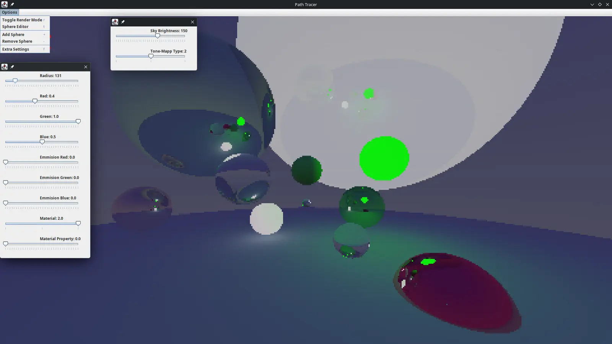

# Java Path-Tracer
## **A simple Java Path-tracer for rendering cool scenes written in a single java class.**

I have done most of the development of this program in VS Code but it was originally made in Bluej. You should be able to ignore all of the redundant files.

**How to Run**
* Download the .jar from the beta releases section
* Make sure you have a java JDK installed
* Double click the file (on Windows) or run "java -jar PathTracer.jar" with the terminal in the location of the file (seems to work better for linux)

**How to Customize**\
There is now a built in scene editor in the program, if you bring the mouse to the top of the window a menu appears allowing you to change the properties of all of the spheres. Most of it is self explanatory.\
Some things that you should know:
* Left/Right arrow keys to change the selected sphere, the one you select will flash white.
* WASDQE to move the selected sphere in any direction.
* The 'Material Property' slider in the sphere editor only applies to glass and metal.
  * On glass this changes the refractive index, how much the light bends.
  * On metal this changes the fuzziness, stops having an affect for any value above 1.0. 
* All extra key binds are shown in the menus.
* You can open the 'Extra Settings' menu to customize the sky brightness, the tone map type, and whether or not to show the red debug info.

If you want to go deeper:

* Download the source code
* Extract the zip
* Open the extracted folder in VS Code
* Install the java extension pack for VS Code to run and compile java.
* Run the Main.java class to launch the program.

At the top of the program there are a bunch of finals that effect the various parts of the render engine. You can play around with these to change performance and other aspects.

**The Menus :)**

You can see that the render here is simplifies and has no noise. This is an alternate rendering method for when you are in edit mode. Note that fuzzy metals are unable to be previewed in this mode, you will need to check them in the render mode.

**Features**
* Multi Threading
* Matte materials using lambertian scattering
* Reflective Metal Surfaces with variable fuzziness
* Performance metric display
* Running average accumulation
* Optional tone mapping
* Comprehensive customizability and scene editor.
* Alternative noiseless render for the editor preview.

**How It Works:**
Every pixel on the screen sends out a ray that bounces around and gathers information about the environment. When finished it will return a color that is an proximate of the final colour based on the direction it randomly bounced. The program repeats this for many layers, each one may bounce the ray in a different direction giving it more information of the scene. The image that is rendered is an average of every layer that was calculated. You can see the amount of layers in the top left corner along with other metrics such as FPS.

For more information you can google it or look at the book that I constantly referenced to build this project:
https://raytracing.github.io/books/RayTracingInOneWeekend.html
